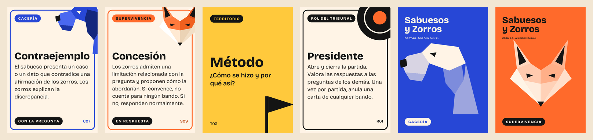

# Sabuesos y Zorros

**Un juego de cartas para defender proyectos ante un tribunal.**



Los **sabuesos** son el tribunal: buscan las debilidades del proyecto. Los **zorros** son quienes lo defienden: una persona o un equipo. Cada pregunta es una jugada, cada parte del proyecto es un territorio que se disputa, y las cartas cambian las reglas del intercambio: limitan el tiempo, piden un dibujo, invierten la carga de la prueba o premian reconocer una limitación. Lo que se caza son debilidades del proyecto, nunca personas.

El juego sirve para dos situaciones:

- **Modo ensayo:** simulacros de defensa con compañeros, supervisores o profesores.
- **Modo tribunal:** la defensa real, con las cartas que no impiden evaluar a cada estudiante.

Funciona con TFG, TFM, tesis doctorales y proyectos en equipo, con tribunales de 1 a 5 personas.

> **Estado:** Beta 2 (0.2.0-beta). Las reglas están completas pero aún no se han probado en partidas reales. Tus [informes de partida](CONTRIBUTING.md#informes-de-partida) son la mejor ayuda.

## Empezar a jugar

1. Descarga e imprime [`imprimir/SyZ-Beta2-imprimible.pdf`](imprimir/SyZ-Beta2-imprimible.pdf) en A4, a escala 100 %. Si tu impresora imprime a doble cara, usa [`imprimir/SyZ-Beta2-doble-cara.pdf`](imprimir/SyZ-Beta2-doble-cara.pdf).
2. Recorta las 57 cartas (63 × 88 mm, tamaño póquer).
3. Consigue fichas de dos colores: sirven monedas o botones.
4. Lee el [reglamento](docs/reglamento.md). La sección 7 resume cómo ajustar el juego al tamaño del tribunal y al tiempo disponible.

## Contenido del repositorio

| Ruta | Qué contiene |
| --- | --- |
| [`docs/reglamento.md`](docs/reglamento.md) | Reglas completas y textos de todas las cartas |
| [`docs/fundamentos.md`](docs/fundamentos.md) | Literatura que sostiene el diseño y preguntas abiertas |
| [`docs/historial-de-diseno.md`](docs/historial-de-diseno.md) | De la Beta 1 (2015) a la Beta 2 (2026) |
| [`docs/hoja-de-observacion.md`](docs/hoja-de-observacion.md) | Plantilla para registrar partidas de prueba |
| [`cartas/cartas.csv`](cartas/cartas.csv) | Datos de todas las cartas: fuente única para el PDF y futuras versiones digitales |
| [`herramientas/generar_cartas.py`](herramientas/generar_cartas.py) | Generador del kit imprimible a partir del CSV |
| [`imprimir/`](imprimir) | PDF listos para imprimir |
| [`fuentes/`](fuentes) | Tipografía Bricolage Grotesque y su licencia |
| [`historico/beta-1-2015/`](historico/beta-1-2015) | Documento y prototipos originales de la Beta 1 |

## Modificar las cartas

Todas las cartas viven en `cartas/cartas.csv`. Para cambiar un texto, añadir una carta o ajustar el número de copias, edita el CSV y regenera los PDF:

```bash
pip install -r requirements.txt
python3 herramientas/generar_cartas.py
```

Los PDF nuevos aparecen en `imprimir/`. Columnas del CSV: `id`, `tipo` (cacería, supervivencia, rol, territorio, rúbrica), `nombre`, `copias`, `momento`, `solo_ensayo` (1 o 0), `solo_grupo` (1 o 0) y `texto`.

## Contribuir

Las contribuciones más útiles ahora mismo son informes de partidas de prueba, propuestas de cartas y traducciones. Consulta [CONTRIBUTING.md](CONTRIBUTING.md).

## Licencias

- **Contenido del juego** (reglas, textos de las cartas, ilustraciones, documentos y PDF): [Creative Commons Atribución 4.0 Internacional](LICENSES/CC-BY-4.0.txt).
- **Código** (`herramientas/`): [MIT](LICENSES/MIT.txt).
- **Tipografía** Bricolage Grotesque: [SIL Open Font License 1.1](fuentes/OFL.txt).

Detalles en [LICENSE.md](LICENSE.md). Puedes copiar, adaptar, traducir y usar el juego, también con fines comerciales, siempre que cites la autoría. Una atribución adecuada:

> *Sabuesos y Zorros*, de Ariel Ortiz Beltrán, CC BY 4.0. https://github.com/ludthor/sabuesos-y-zorros

## Cómo citar

Si usas el juego en docencia o investigación, cítalo con los datos de [CITATION.cff](CITATION.cff):

> Ortiz Beltrán, A. (2026). *Sabuesos y Zorros: un juego de cartas para defender proyectos ante un tribunal* (versión 0.2.0-beta) [Juego de cartas]. https://github.com/ludthor/sabuesos-y-zorros

## Autoría

Diseño original, reglas, textos e ilustraciones: **Ariel Ortiz Beltrán** ([ORCID 0000-0003-1522-2362](https://orcid.org/0000-0003-1522-2362)). La primera versión del juego data de 2015.

---

## English summary

*Sabuesos y Zorros* ("Hounds and Foxes") is a card game for oral project defences, such as thesis vivas and capstone presentations. The examining panel plays the hounds, who hunt for weaknesses in the project; the students play the foxes, who defend it. Cards change the rules of the exchange, and each part of the project is a territory won over the best of three questions. The game has a rehearsal mode and a real-defence mode, and works with panels of one to five people. The materials are currently in Spanish. Content is licensed under CC BY 4.0, code under MIT, and the typeface under the SIL OFL 1.1. Translations are welcome.
